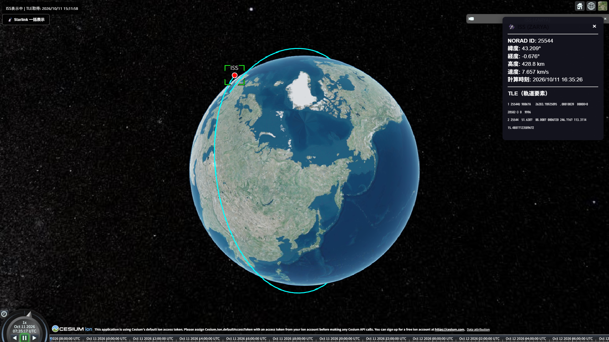
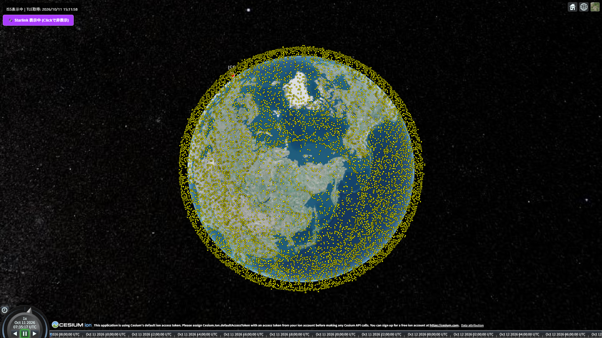

# 🛰️ Satellite 3D Tracker (衛星軌道 3D トラッカー)

Cesium.js および satellite.js を用いて、国際宇宙ステーション（ISS）や Starlink 衛星群のリアルタイムな現在位置および将来の軌道を 3D 地球儀上に視覚化する Web アプリケーションです。

---

## ✨ 特徴・機能

- **ISS（国際宇宙ステーション）のリアルタイム追跡**
  - CelesTrak から最新の TLE（2行軌道要素形式）データを自動取得し、リアルタイムに位置を追跡・描画します。
  - ISS アイコンをクリックすると、**今後100分間の予測軌道**を表示し、詳細な軌道情報パネル（緯度・経度・高度・速度・TLE原文）を展開します。
- **Starlink 衛星群の一括可視化**
  - ボタン1つで数千基におよぶ Starlink 衛星の現在位置を一括描画します。
  - レンダリングパフォーマンスを考慮した Cesium の描画最適化（`suspendEvents` / `resumeEvents`）を実装しています。
- **データキャッシュ & レジリエンス設計**
  - API 制限（CelesTrak への過剰リクエスト防止）およびオフライン対応のため、`localStorage` による TLE キャッシュ（2時間有効）とフォールバック機能を搭載しています。

---

## 🛠️ 技術スタック

- **Core Framework:** React 18, TypeScript, Vite
- **3D Render Engine:** Cesium.js
- **Orbit Calculation:** satellite.js
- **API Target:** CelesTrak (NORAD 軌道要素データ)

---

## 🚀 ローカル環境での起動手順

本リポジトリにはソースコードのみが含まれています。ビルド成果物（`dist/`）や依存ライブラリ（`node_modules/`）はコミット対象外となっていますので、以下の手順で手元で環境を構築して実行してください。

### 1. 依存関係のインストール

```bash
npm create vite@latest satellite-orbit -- --template react-ts
cd satellite-orbit
npm install cesium satellite.js
npm install -D vite @vitejs/plugin-react
mkdir public\cesium
xcopy /E /I /Y node_modules\cesium\Build\Cesium\Workers public\cesium\Workers
xcopy /E /I /Y node_modules\cesium\Build\Cesium\Widgets public\cesium\Widgets
xcopy /E /I /Y node_modules\cesium\Build\Cesium\Assets public\cesium\Assets
xcopy /E /I /Y node_modules\cesium\Build\Cesium\ThirdParty public\cesium\ThirdParty

```

### 2. 開発用サーバーの起動

```bash
npm run dev
```

ターミナルに表示されたローカル URL（例: `http://localhost:5173`）をブラウザで開いてください。

---

## 📷 Screenshots






---

## ⚙️ API プロキシと環境設定

開発環境における CORS 回避および CelesTrak への直接アクセスをスムーズにするため、`vite.config.ts` で以下のプロキシ転送を設定しています。

- **リクエスト**: `/api/celestrak?...`
- **転送先**: `https://celestrak.org/NORAD/elements/gp.php?...`

---

## 📄 License & Copyright

This project is released under the [Apache License 2.0](LICENSE).

Copyright (c) 2026 Freelancer JOE. All Rights Reserved.